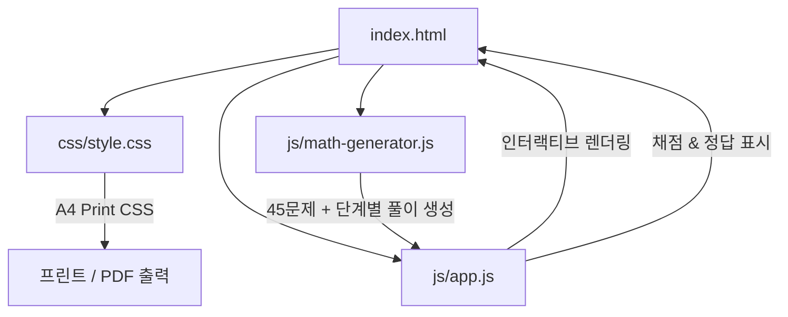

# 초등학교 2학년 곱셈 세로셈 학습지 구현 계획

> **For agentic workers:** REQUIRED SUB-SKILL: Use superpowers:subagent-driven-development to implement this plan task-by-task. Steps use checkbox (`- [ ]`) syntax for tracking.

**Goal:** 초등 2학년 두 자릿수 X 한 자릿수 세로셈 5페이지(페이지당 9문제) 학습지 + 답지 웹 앱 개발 및 GitHub Pages 배포

**Architecture:** 단일 페이지 웹 애플리케이션(SPA) 구조로 HTML, CSS, JS를 분리하여 가독성과 유지보수성을 극대화합니다. 수학적 문제 생성기 및 풀이 단계 분해 로직(수학 엔진), 반응형 및 인쇄 전용 그리드 레이아웃(디자인 시스템), 키보드 포커스 제어 및 채점 시스템(인터랙션)을 구축합니다.

**Architecture Diagram:**

**Tech Stack:** HTML5, CSS3 (CSS Grid/Flexbox, Print Media Query), Vanilla JavaScript (ES6+), GitHub CLI, GitHub Pages

**Spec:** [docs/superpowers/specs/2026-11-11-multiplication-worksheet-design.md](file:///c:/Users/User/Desktop/antigravity/multiplication%20worksheet/docs/superpowers/specs/2026-11-11-multiplication-worksheet-design.md)

## Global Constraints
- 색상: 배경 `#FFF5F5`, 본문 `#7B6B8D`, 강조 `#FFB5C2`, `#B5D8F7`
- 톤: 부드러움, 아기, 포근함, 동화 테마 (토끼, 곰, 구름, 별, 풍선 일러스트 장식)
- 한 페이지당 9문제 (3x3), 총 5페이지 (45문제) + 답안지
- 인쇄 시 A4 용지 규격에 딱 맞게 페이지 분할(`break-after: page`)
- GitHub Pages에서 정적 호스팅 가능하도록 구성

---

### Task 1: 수학 엔진 및 문제 생성 로직 구현 (`js/math-generator.js`)
- [ ] 두 자릿수(11~99)와 한 자릿수(2~9) 난수 생성
- [ ] 단계별 분해 (일의 자리 곱, 십의 자리 곱, 최종 합)
- [ ] 올림 있는 문제와 없는 문제 적절한 비율 생성
- [ ] 5페이지 × 9문제 = 45문제 데이터셋 생성 테스트

### Task 2: 디자인 시스템 및 스타일 구현 (`css/style.css`)
- [ ] 폰트 및 파스텔 팔레트 변수 정의
- [ ] 동화 감성 헤더, 귀여운 SVG 캐릭터(토끼, 곰, 별, 구름)
- [ ] 3x3 그리드 세로셈 카드 UI 및 네모칸(□) 인풋 스타일링
- [ ] A4 인쇄 전용 `@media print` 스타일 (페이지 나눔 및 여백 최적화)

### Task 3: 메인 웹 페이지 및 인터랙션 구현 (`index.html`, `js/app.js`)
- [ ] 페이지 전환 탭 (1~5페이지, 답안지 탭)
- [ ] 입력창 자동 다음 포커스 이동 및 백스페이스 이전 이동
- [ ] 채점하기 및 참 잘했어요 스탬프 애니메이션
- [ ] '새 문제 생성' 및 '인쇄하기' 버튼 연동

### Task 4: GitHub 리포지토리 생성, 커밋, 푸시 및 GitHub Pages 배포
- [ ] git init 및 .gitignore 생성
- [ ] git add & initial commit
- [ ] `gh repo create`로 GitHub 원격 저장소 생성 및 푸시
- [ ] GitHub Pages 활성화 및 배포 링크 확인
